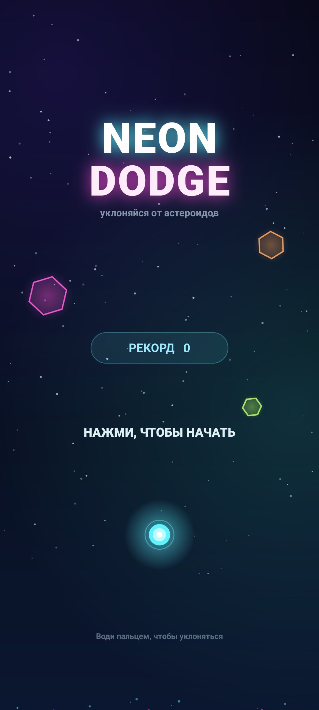

# Neon Dodge 1.7

Неоновая аркада для Android: веди светящуюся сферу пальцем по всей игровой
плоскости и уклоняйся от падающих астероидов. У каждого цвета камня — своя
способность. Собирай звёзды (они растят множитель счёта), лови сердца,
бонусы и комбо, выполняй задания дня и открывай скины.



Полное описание проекта и механик: [PROJECT.md](PROJECT.md).

## Возможности

- Три режима: «Классика» (3 жизни), «Хардкор» (1 жизнь), «Дзен» (без
  проигрыша)
- Пять типов астероидов со своими способностями
- Бонусы: звезда, сердце, щит, магнит, замедление
- Множитель счёта до x5,0: растёт от звёзд, сбрасывается при столкновении
- 10 достижений, ежедневные задания и внутренняя валюта «неон»
- 6 скинов сферы и 5 скинов шлейфа, открываются за прогресс (без покупок)
- Русская и английская локализация, вибрация, музыка и звуки

## Режимы игры

| Режим | Жизни | Особенности |
| --- | --- | --- |
| Классика | 3 | Обычная сложность, сердца восстанавливают жизнь |
| Хардкор | 1 | Одно попадание — конец; сердца не выпадают |
| Дзен | — | Проигрыша нет, попадание сбрасывает комбо; сложность достигает 60 % за 120 с |

Режим выбирается чипами в главном меню и запоминается.

## Бонусы

| Бонус | Эффект |
| --- | --- |
| Звезда | +50 очков и +0,2 к множителю счёта |
| Сердце | +1 жизнь, если их меньше трёх; иначе +60 очков |
| Щит | Поглощает одно попадание |
| Магнит | 8 секунд притягивает звёзды в радиусе 620 |
| Замедление | 6 секунд мир движется с коэффициентом 0,45 |

Щит, магнит и замедление появляются по одному раз в 15–24 секунды.
Звезда — каждые 3–5,6 секунды, сердце — раз в 24 секунды при потере жизни.

## Типы астероидов

| Цвет | Способность |
| --- | --- |
| Зелёный | Отскакивает от стен |
| Синий | Повышенная скорость |
| Фиолетовый | Небольшое наведение на игрока |
| Оранжевый | Движется рывками |
| Красный | Повышенный размер |

## Прогресс

**Ежедневные задания.** Каждый день выбираются три задания из семи:
10 звёзд за забег, 1500 очков за забег, комбо x8, 80 пролётов за забег,
3 забега за день, 30 звёзд за день, 5 минут игры за день. Выбор
детерминирован датой, прогресс сохраняется. Награда — 300 неона.

**Достижения.** 10 целей: первый забег, счёт 1000 и 5000, 500 пролётов,
комбо x10 и x25, 100 звёзд, 10 минут игры, спасение щитом и выживание
2 минуты.

**Неон** — сумма всех заработанных очков (начисляются при завершении
забега или выходе в меню) плюс награды за задания. Неон не тратится: он
открывает скины по порогам.

**Скины сферы (6).** Циан — сразу; магента — 4000 неона; золото —
рекорд 2500; кислота — комбо x12; пульсар — 300 пролётов; призрак —
15 минут игры.

**Скины шлейфа (5).** Неон — сразу; искры — 50 звёзд; пламя — рекорд
4000; тень — 500 пролётов; магнит — 5 выполненных заданий.

## Что внутри

- Нативный Android (Java), без сторонних библиотек и без интернета
- Вся графика рисуется на `Canvas`, 60 FPS через `Choreographer`
- Экраны: меню с режимами, настройки, игра, пауза, правила, статистика,
  задания, скины, game over
- `Progress.java` хранит статистику, достижения, задания, скины и режим
- Синтезированные звуки (`SoundPool`), зацикленная музыка (`MediaPlayer`)
  и вибрация
- Адаптивная иконка, полноэкранный immersive-режим, учёт вырезов экрана
- minSdk 26 (Android 8.0), targetSdk 36 (Android 16)
- `applicationId`: `com.isaev.neondodge`, `versionCode` 8, `versionName` 1.7
- Разрешение только `VIBRATE`; интернет, реклама, аналитика и покупки
  отсутствуют

## Сборка

Нужен JDK 17+ и Android SDK 36.

```powershell
$env:JAVA_HOME="<путь к JDK>"
.\gradlew.bat assembleRelease
```

Готовый файл: `app/build/outputs/apk/release/app-release.apk`.

Подпись релиза настраивается в `keystore.properties` (не коммитится)
или через переменные окружения `NEONDODGE_STORE_FILE`,
`NEONDODGE_STORE_PASSWORD`, `NEONDODGE_KEY_ALIAS`,
`NEONDODGE_KEY_PASSWORD`. Ключ хранится в `keystore/release.jks`.

Пример `keystore.properties`:

```properties
storeFile=keystore/release.jks
storePassword=<пароль хранилища>
keyAlias=<alias>
keyPassword=<пароль ключа>
```

Финальная подпись v1+v2+v3 с выравниванием:

```powershell
powershell -ExecutionPolicy Bypass -File .\tools\sign-release.ps1 `
  -InputApk .\app\build\outputs\apk\release\app-release.apk `
  -OutputApk .\NeonDodge-1.7.apk
```

Скрипт делает `zipalign -p -f 4`, подписывает через `apksigner` с
включёнными v1/v2/v3 и проверяет результат.

## Установка на телефон

```powershell
adb install -r NeonDodge-1.7.apk
```

Либо скопируйте APK на телефон и откройте (нужно разрешить установку
из неизвестных источников).

## Управление

- В меню — чипы режимов и крупные кнопки разделов сеткой 2×2, ниже —
  широкая кнопка «Правила»; игра начинается только по кнопке
  «Нажми, чтобы начать»
- В игре — ведите пальцем в любую сторону: сфера следует по горизонтали
  и вертикали
- Тип управления («над пальцем» или «прямо у пальца») и высота сферы
  настраиваются в «Настройках» главного меню
- Кнопка паузы — справа сверху; «назад» — пауза, из паузы — меню
- В паузе — музыка, звук, вибрация, «Правила» и «В меню»; продолжить
  можно только по кнопке «Нажми, чтобы продолжить»
- Экран проигрыша показывает режим, звёзды, комбо, пролёты, время и
  максимальный множитель; кнопки «Ещё раз» и «В меню»

## Структура

```
app/src/main/java/com/isaev/neondodge/
  MainActivity.java   — immersive-режим, insets, жизненный цикл
  GameView.java       — игровой цикл, физика, рендер, звук, ввод
  Progress.java       — статистика, достижения, задания, скины, режим
app/src/main/res/
  raw/                — синтезированные WAV-звуки и музыка
  drawable/           — векторная иконка
  values/             — русские строки (по умолчанию)
  values-en/          — английские строки
screenshots/          — скриншоты игры
tools/                — генерация ассетов/аудио и подпись APK
PROJECT.md            — полное описание проекта
SUMMARY-1.5.md        — сводка проекта и изменений версии 1.5
```

Аудио пересобирается командой:

```powershell
node tools/make_audio.js
```
