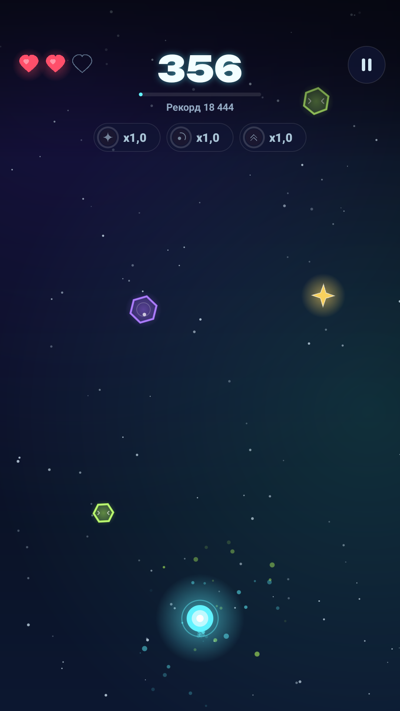
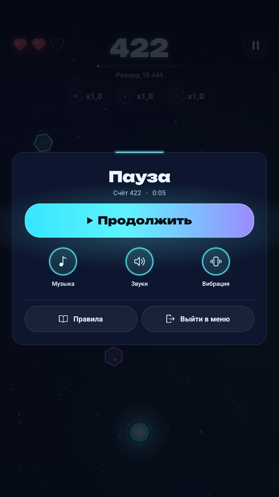
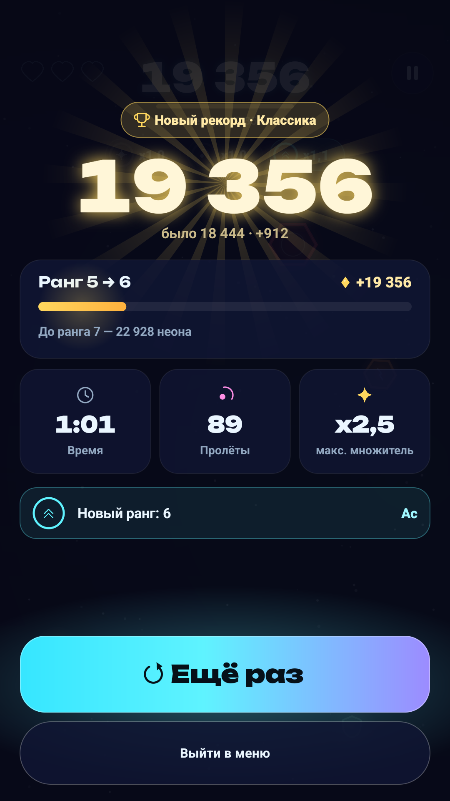

# Neon Dodge 1.8

Неоновая аркада для Android: ведите светящуюся сферу пальцем по всей игровой плоскости, уклоняйтесь от астероидов, собирайте бонусы и улучшайте рекорды. Версия 1.8 добавляет многоэтапных боссов с зонами, мастерскую из четырёх веток, хардкорный x5, ранги игрока и новый облик «космическая аркада» со шрифтом Unbounded.

| Меню | Забег | Пауза | Итог забега |
| --- | --- | --- | --- |
|  |  |  |  |

Кадры сняты `adb screencap` с release-сборки 1.8 на эмуляторе Android 16 (API 36).
Для съёмки на рабочей машине с Android SDK используйте `tools/capture-screenshots.ps1`.
Скрипт устанавливает `dist/NeonDodge-1.8.apk`, запускает игру, автоматически сохраняет
меню и игровой экран, а затем просит вручную открыть паузу и game over:

```powershell
powershell -ExecutionPolicy Bypass -File .\tools\capture-screenshots.ps1
```

Полное описание механик и устройства проекта: [PROJECT.md](PROJECT.md). История изменений: [CHANGELOG.md](CHANGELOG.md).
Сводка текущего обновления: [SUMMARY-1.8.md](SUMMARY-1.8.md). История плана: [NEXT-1.8.md](NEXT-1.8.md).

## Возможности

- Три режима: «Классика» (3 жизни), «Хардкор» (1 жизнь) и «Дзен» (без проигрыша; попадание сбрасывает комбо).
- Испытание дня: одна попытка, фиксированный seed и отдельный рекорд.
- Девять типов астероидов и мини-боссы на 2-й, 4-й и 6-й минуте; босс выпускает пули и требует заполнить четыре зоны.
- Бонусы: звезда, сердце, щит, магнит, замедление, бомба, фаза и x2 к очкам.
- В «Мастерской» четыре ветки по 20 уровней: множитель звёзд, прибавка за близкий пролёт, награда босса и постоянный множитель каждого игрового уровня. Цены растут после каждой покупки.
- «Хардкор» постоянно даёт дополнительный множитель x5 на время текущего забега.
- Три ежедневных задания из девяти с наградой 300 неона.
- 13 достижений, 9 вариантов ежедневных заданий, статистика и история последних 10 забегов.
- 8 скинов сферы и 7 скинов шлейфа, открываемых игровым прогрессом.
- Управление «над пальцем» или «прямо у пальца», настраиваемая высота сферы.
- Русская и английская локализация, музыка, звуки и вибрация с отдельными переключателями.
- Полностью офлайн: без рекламы, покупок, аккаунтов, аналитики и сетевых разрешений; музыка уступает audio focus другим приложениям.

## Режимы игры

| Режим | Жизни | Особенности |
| --- | --- | --- |
| Классика | 3 | Обычная сложность, сердца восстанавливают жизнь |
| Хардкор | 1 | Одно попадание — конец; сердца не появляются; активен дополнительный x5 |
| Дзен | — | Проигрыша нет; попадание сбрасывает комбо и оба множителя, очки не превращаются в неон |

Режим выбирается в главном меню и сохраняется на устройстве.

## Бонусы

| Бонус | Эффект |
| --- | --- |
| Звезда | +50 очков и прибавка к звёздному множителю по уровню мастерской |
| Сердце | +1 жизнь, если жизней меньше трёх; иначе +60 очков |
| Щит | Поглощает одно попадание |
| Магнит | 8 секунд притягивает звёзды |
| Замедление | 6 секунд замедляет мир до 45 % скорости |
| Бомба | Взрывает ближайшие астероиды и даёт очки |
| Фаза | 6 секунд позволяет проходить сквозь астероиды |
| x2 | Удваивает начисление очков на 8 секунд |

Близкий пролёт повышает отдельный множитель; он показан рядом со звёздным множителем. После четырёх зон босс выдаёт улучшенный множитель. Переход на новый игровой уровень навсегда увеличивает множитель до конца забега. Щит поглощает попадание и сохраняет множители.

«Мастерская» открывается из неоновой панели меню. Каждая из четырёх веток имеет максимум 20 уровней, а цена следующего уровня растёт примерно в 1,5 раза; базовые цены веток — 25 000, 40 000, 60 000 и 80 000 неона.

## Прогресс

Неон начисляется за очки в «Классике», «Хардкоре» и испытании дня, а также за выполненные задания. В «Дзене» очки остаются тренировочным рекордом и не начисляют неон. Рекорды хранятся отдельно для каждого режима.

Ежедневно выбираются три задания из девяти: к базовым заданиям добавлены выживание в «Хардкоре» и прохождение испытания дня. Испытание дня сбрасывается раз в сутки и доступно один раз.

## Что внутри

- Нативный Android на Java без сторонних библиотек.
- Canvas-рендеринг с игровым циклом через `Choreographer`.
- Экраны меню, правил, настроек, статистики, заданий, мастерской, скинов, паузы и game over.
- `Progress.java` хранит рекорды режимов, статистику, достижения, задания, историю и выбранные скины.
- minSdk 26 (Android 8.0), targetSdk 36 (Android 16).
- `applicationId`: `com.isaev.neondodge`, `versionCode` 9, `versionName` 1.8.
- Единственное разрешение — `android.permission.VIBRATE`.

## Сборка

Нужен JDK 17+ и Android SDK 36.

```powershell
$env:JAVA_HOME="<путь к JDK>"
.\gradlew.bat assembleRelease
```

Подписанный APK можно собрать скриптом:

```powershell
powershell -ExecutionPolicy Bypass -File .\tools\sign-release.ps1 `
  -InputApk .\app\build\outputs\apk\release\app-release.apk `
  -OutputApk .\NeonDodge-1.8.apk
```

Скрипт выполняет `zipalign`, включает подписи v1/v2/v3 и проверяет APK. Ключ и пароли задаются в `keystore.properties` или переменных `NEONDODGE_*`; секреты не хранятся в Git.

## Установка

```powershell
adb install -r NeonDodge-1.8.apk
```

## Управление

- В меню выберите режим на карточке-портале и нажмите «Играть».
- В игре ведите пальцем в любую сторону: сфера плавно следует за точкой касания.
- В «Настройках» выберите положение сферы, высоту над пальцем и переключатели музыки, звуков и вибрации.
- Пауза находится справа сверху. Системная кнопка «Назад» ставит активный забег на паузу.

## Структура

```
app/src/main/java/com/isaev/neondodge/  — код игры
app/src/main/res/                       — ресурсы и локализация
screenshots/                            — кадры APK (нужно снять на эмуляторе/устройстве)
tools/capture-screenshots.ps1            — съёмка кадров из установленного APK через adb
store/                                  — карточка RuStore и её ассеты
PROJECT.md                              — техническое описание
CHANGELOG.md                            — история версий
```
