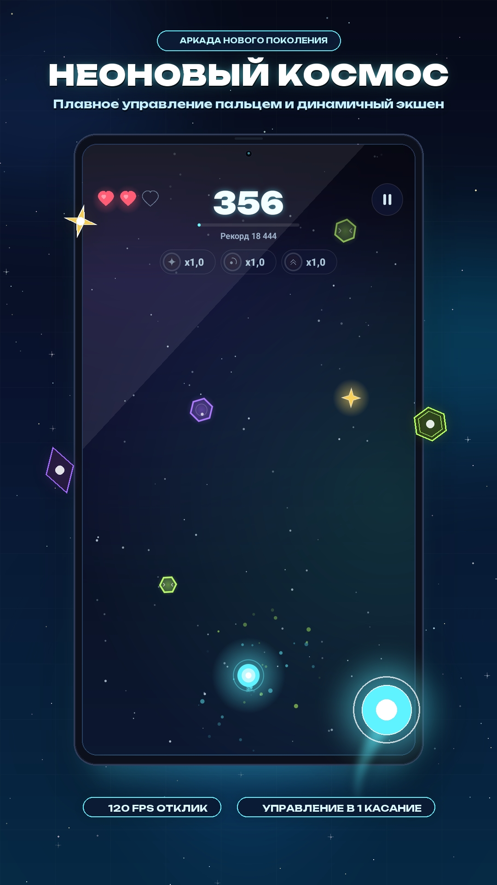
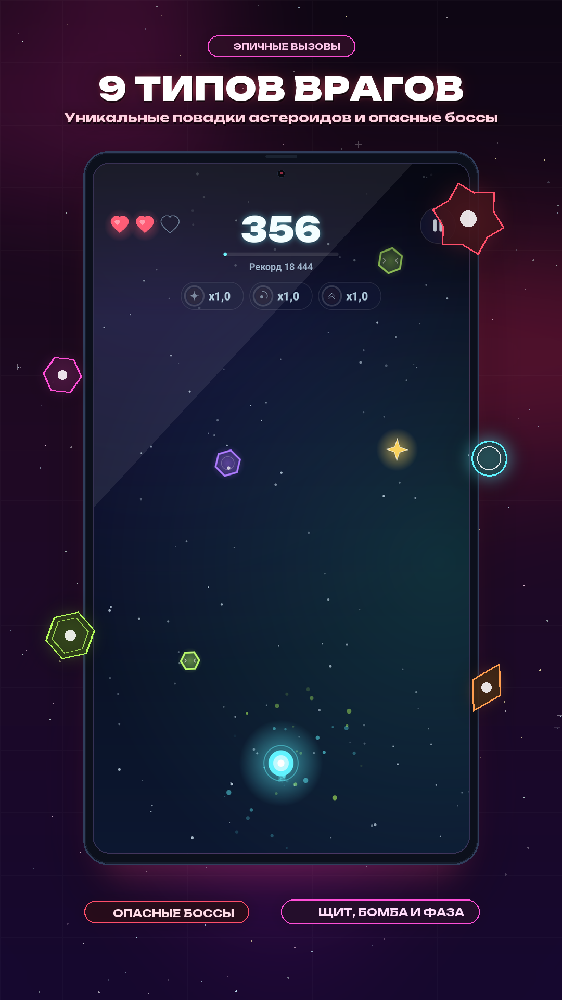
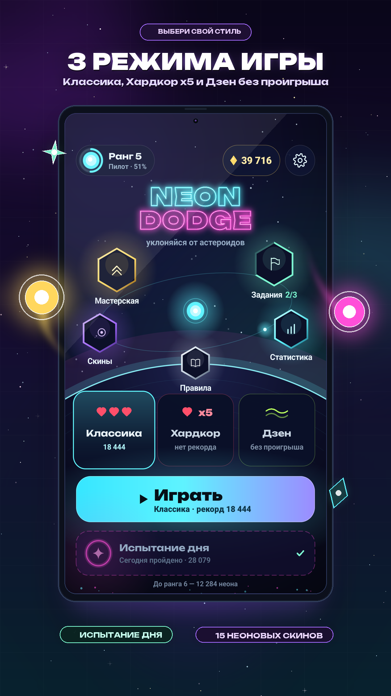
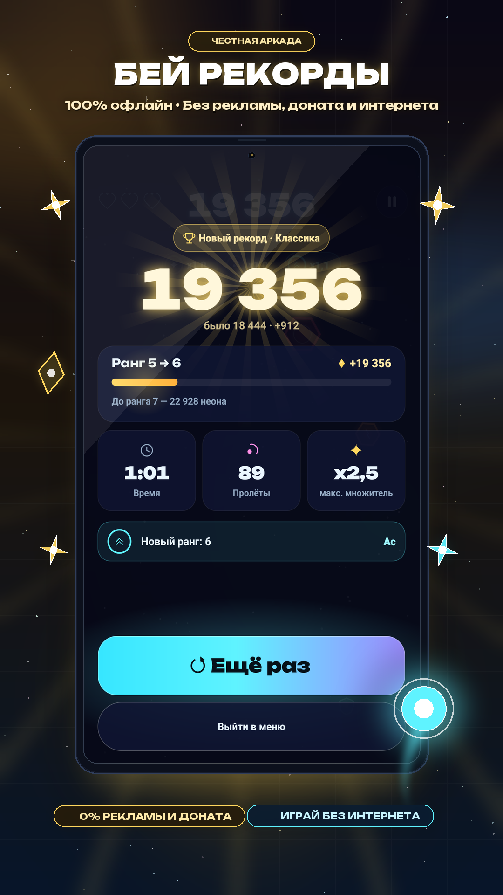

# Neon Dodge 2.3

Неоновая аркада для Android: ведите светящуюся сферу пальцем по всей игровой плоскости, уклоняйтесь от астероидов, собирайте бонусы, побеждайте титанов и улучшайте корабль в Мастерской. Версия 2.3 добавляет рекламу Яндекс Рекламы с адаптивным баннером и rewarded-возрождением, сохраняя полный визуальный редизайн, дуэли с 4 Титанами и оптимизацию графики 60/120 FPS.

| Геймплей | Противники | Режимы | Рекорды |
| :---: | :---: | :---: | :---: |
|  |  |  |  |

Полное описание механик и архитектуры: [PROJECT.md](PROJECT.md). Подробная история версий: [CHANGELOG.md](CHANGELOG.md).

## Возможности

- **3 игровых режима**:
  - «Классика» — 3 жизни, сердца восстанавливают прочность корпуса, сбалансированная кривая сложности.
  - «Хардкор» — 1 жизнь, отсутствие сердец, постоянный бонус +50% к добыче неона.
  - «Дзен» — бессмертный медитативный режим для тренировки; урон сбрасывает комбо без потери жизней.
- **9 уникальных классов врагов**:
  - *Неоновый сюрикен (Зелёный)* — 4-лопастной клинок со сжатием/растяжением (squash & stretch) при рикошете от стен и встречно вращающимся ядром.
  - *Сверхзвуковой перехватчик (Синий)* — стреловидный дельта-дрон с синхронным креном, ударными волнами Маха и спаренными плазменными дюзами.
  - *Дрон-охотник (Фиолетовый)* — восьмигранный каркас с маневровыми RCS-соплами и кибернетическим глазом, активно сопровождающим игрока в прицеле.
  - *Импульсный сокол (Оранжевый)* — ракета, динамически вытягивающаяся во время форсажа, с ромбами Маха в факеле и управляемыми закрылками.
  - *Тяжёлый дредноут (Красный)* — колоссальный 8-шиповый титан с пульсирующим магматическим ядром, расходящимися гравитационными волнами массы и разломами.
  - *Бинарный кристалл (Жёлтый)* — спаренные кристаллы с преддетонационной вибрацией, искрящимися дугами разряда и раскалыванием на осколки.
  - *Орбитальная мина (Бирюзовый)* — сфера с 8 сенсорными шипами, расширяющимся сонаром радиуса поражения, учащающимся стробоскопом тревоги и круговой шкалой детонатора.
  - *Космическая сингулярность (Чёрная дыра)* — горизонт событий с 4-рукавным аккреционным диском, втягиванием материи и пространственным искажением.
  - *Бастион Эгида (Белый)* — композитный бронепанцирь со структурными заклёпками и вращающимся силовым щитом.
- **Битвы с Титанами 2.0**:
  - Спавн обычных астероидов полностью замораживается на время боссфайта.
  - 4 босса с уникальными атаками: **Prism Core** (прицельный лазер и веера снарядов), **Vortex Prime** (Danmaku-спирали и гравитационная воронка), **Apex Striker** (световые барьеры и сверхзвуковой таран), **Nexus Overlord** (лазерная решётка и радиальные залпы).
  - Интерактивный урон: замыкание узлов перегрузки (Conduits) для оглушения босса электроударом и отражение фиолетовых ядер опасным сближением (*Close Dodge*).
  - Кинематографичный финал: слоу-мо ($0.2\times$), импульсные ударные волны, разлёт и магнитное втягивание 12 сфер эссенции титана с роллап-счётчиком очков.
- **Мастерская 2.0 (12 веток прокачки)**:
  - 3 удобные категории: «Множители», «Корабль и щит», «Модули и титаны».
  - Мощные улучшения: Нано-щит (до 2 зарядов щита одновременно), Аварийный сдвиг (спасение от верной гибели раз за забег), Магнитная аура (пассивный радиус сбора), Второе дыхание (экстренный призыв сердец при 1 HP), Жатва эссенции, Перегрузка узлов и др.
  - Сбалансированная полиномиальная кривая цен без бесконечного гринда.
- **Бонусы на поле боя**: Звезда (+множитель), Сердце (+HP), Щит, Магнит, Замедление времени, Бомба (ударная волна с радиусом), Фаза (прохождение сквозь материю) и x2 к очкам.
- **Кастомизация и прогресс**:
  - 8 скинов сферы и 7 неоновых шлейфов, открывающихся за игровые достижения.
  - 13 достижений, подробная статистика и лента истории последних 10 забегов.
  - Живая анимированная энциклопедия врагов и механик в разделе «Правила игры».
- **Управление и комфорт**:
  - Выбор положения: «над пальцем» (с регулировкой высоты 0–300 px) или «прямо у пальца».
  - Полная поддержка 60 и 120 Гц экранов.
  - Локализация: русский и английский языки.
  - Адаптивный баннер Яндекс Рекламы в меню и во время забега; rewarded-реклама один раз за забег возвращает одну жизнь.

## Режимы игры

| Режим | Жизни | Особенности |
| :--- | :---: | :--- |
| **Классика** | 3 | Сбалансированная сложность, сердца восстанавливают жизни, стандартная добыча неона |
| **Хардкор** | 1 | Одно касание — гибель; сердца отключены; постоянный бонус +50% к добываемому неону |
| **Дзен** | ∞ | Бессмертный режим; касание сбрасывает комбо; тренировочный счёт без начисления неона |

## Бонусы

| Бонус | Эффект |
| :--- | :--- |
| **Звезда** | +50 очков и рост множителя звёзд согласно уровню прокачки в Мастерской |
| **Сердце** | +1 HP (до 3 максимум); при полном запасе жизней даёт бонусные очки |
| **Щит** | Поглощает прямое попадание; с улучшением «Нано-щит» накапливает до 2 зарядов |
| **Магнит** | 8 секунд притягивает звёзды и кристаллы со всего экрана |
| **Замедление** | 6 секунд снижает скорость мира до 45% |
| **Бомба** | Создаёт расширяющуюся взрывную волну, аннигилирующую препятствия на экране |
| **Фаза** | 6 секунд позволяет беспрепятственно проходить сквозь любые астероиды |
| **x2** | Удваивает весь входящий счёт на 8 секунд |

## Технические детали

- **Движок**: чистый нативный Android (Java) без тяжелых игровых движков; реклама подключена через Yandex Mobile Ads SDK 8.6.0.
- **Рендеринг**: аппаратный Canvas с синхронизацией кадров через `Choreographer`. Zero-GC allocations во время геймплея.
- **Целевая платформа**: minSdk 26 (Android 8.0 Oreo), targetSdk 36 (Android 16).
- **Идентификатор**: `com.isaev.neondodge`, `versionCode` 24, `versionName` 2.3.
- **Разрешения**: `android.permission.VIBRATE`, `android.permission.INTERNET` и `android.permission.ACCESS_NETWORK_STATE` для загрузки рекламы.

## Сборка проекта

Для сборки требуется JDK 17+ и Android SDK 36:

```powershell
# Установка переменной окружения (при необходимости)
$env:JAVA_HOME="<путь к JDK>"

# Сборка релизного APK
.\gradlew.bat assembleRelease
```

Собранный файл появится в `app/build/outputs/apk/release/app-release.apk`.

## Установка через ADB

```powershell
adb install -r NeonDodge-2.3.apk
```

## Структура проекта

```
app/src/main/java/com/isaev/neondodge/  — исходный код игры (архитектура слоёв)
app/src/main/res/                       — векторная графика, звуки, музыка и локализация
store/cards/                            — промо-карточки и баннеры для маркетов
PROJECT.md                              — подробное архитектурное и техническое описание
CHANGELOG.md                            — полный журнал изменений всех версий
```
